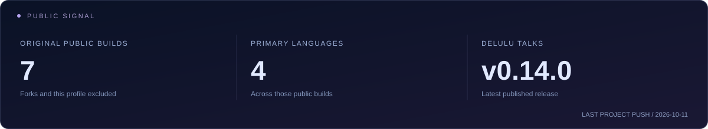

  <picture>
    <source media="(max-width: 640px)" srcset="assets/noctis-hero-compact.svg" />
    
  </picture>

  <h3>I build tools that make a computer feel more like yours.</h3>

  
Local AI. Thoughtful desktop apps. Automation with a purpose. 
  By day, I work on laboratory software at <a href="https://labservant.com"><strong>LabServant</strong></a>. 
  After hours, I turn curious ideas into things you can actually use.

  

    
    
    
  

  
<a href="#the-armory"><strong>The armory</strong></a> &nbsp; ✦ &nbsp; <a href="#at-labservant"><strong>LabServant</strong></a> &nbsp; ✦ &nbsp; <a href="#the-toolkit"><strong>The toolkit</strong></a> &nbsp; ✦ &nbsp; <a href="#the-observatory"><strong>The observatory</strong></a>

## The armory

Four projects, four ways to put more control in your hands.

<a href="https://github.com/JEMostert/delulu-talks">
  <picture>
    <source media="(max-width: 640px)" srcset="assets/project-delulu-compact.svg" />
    
  </picture>
</a>

**Speak. Keep working.** Local speech recognition, personal corrections, live typing, and optional local rewriting. A desktop voice companion with a living ocean interface.

`Electron` · `React` · `TypeScript` · `Python` · `MLX / CUDA`

[Explore the project →](https://github.com/JEMostert/delulu-talks) &nbsp; · &nbsp; [Download a release](https://github.com/JEMostert/delulu-talks/releases/latest)

<strong>Open a window into Delulu Talks</strong>

 
<picture>
  <source media="(prefers-color-scheme: light)" srcset="https://raw.githubusercontent.com/JEMostert/delulu-talks/master/docs/assets/controls-light.png" />
  
</picture>

Project screenshot from the browser preview with demo text.

 

<a href="https://github.com/JEMostert/computer-artist">
  <picture>
    <source media="(max-width: 640px)" srcset="assets/project-artist-compact.svg" />
    
  </picture>
</a>

**Give an agent its own lane.** A native KWin plugin and programmable CLI for independent desktop input, reusable actions, and private agent environments on KDE Wayland.

`Python` · `C++` · `KWin` · `Wayland` · `CLI`

[Explore the project →](https://github.com/JEMostert/computer-artist) &nbsp; · &nbsp; [See how it works](https://github.com/JEMostert/computer-artist/blob/main/docs/CAPABILITIES.md)

 

<a href="https://github.com/JEMostert/IndexExpress">
  <picture>
    <source media="(max-width: 640px)" srcset="assets/project-index-compact.svg" />
    
  </picture>
</a>

**A quick peek or a deep investigation.** Four research modes—peek, skim, analyze, research—with source-cited answers, evidence graphs, MCP tools, and a terminal interface.

`Python` · `MCP` · `SearXNG` · `Local LLMs` · `TUI`

[Explore the project →](https://github.com/JEMostert/IndexExpress) &nbsp; · &nbsp; [Read the research contract](https://github.com/JEMostert/IndexExpress#report-contract)

 

<a href="https://github.com/JEMostert/Model-yard">
  <picture>
    <source media="(max-width: 640px)" srcset="assets/project-yard-compact.svg" />
    
  </picture>
</a>

**Your local models, one workbench.** Streaming chat, generation controls, model management, and exportable run history, with a Rust backend talking directly to Ollama.

`Tauri` · `Rust` · `React` · `TypeScript` · `Ollama`

[Explore the project →](https://github.com/JEMostert/Model-yard) &nbsp; · &nbsp; [Under the hood](https://github.com/JEMostert/Model-yard#architecture)

<strong>Step inside Model Yard</strong>

 

## At LabServant

<a href="https://labservant.com">
  <picture>
    <source media="(max-width: 640px)" srcset="assets/labservant-compact.svg" />
    
  </picture>
</a>

I work on software that helps laboratories manage their daily operations. My work reaches across:

- **Laboratory workflows:** equipment, ordering, inventory, reservations, and risk assessment.
- **Interface modernization:** Laravel and Livewire screens, reusable components, grids, and the details that make a busy interface easier to use.
- **The connective tissue:** integrations, exports, printing, authorization, and maintaining the bridge between modern and legacy code.
- **Developer tooling:** repository-aware AI workflows, component guidance, localization, and documentation.

I like working through the whole feature: data and behavior, the interface people touch, and verification in the actual browser.

[Meet LabServant ↗](https://labservant.com)

## The toolkit

  
  
  
  

  
  
  
  

  
  
  
  

**My recurring rabbit holes:** speech models, agent tools, desktop UX, game experiments, and making complicated systems feel approachable.

<strong>Side quests &amp; earlier chapters</strong>

From PHP CRUD and canvas games to desktop AI and native input systems:

- [Garage](https://github.com/JEMostert/Garage) — early PHP application work.
- [bobgame](https://github.com/JEMostert/bobgame) — JavaScript canvas experiments.
- [BFGautofarmGT](https://github.com/JEMostert/BFGautofarmGT) — an early Python automation experiment.
- [DeepSeek Harness fork](https://github.com/JEMostert/deepseek-harness-electron) — desktop experimentation with an existing agent harness.

## The observatory

<picture>
  <source media="(max-width: 640px)" srcset="assets/observatory-compact.svg" />
  
</picture>

A small signal from my public repositories, refreshed by GitHub Actions.

  <picture>
    <source media="(max-width: 640px)" srcset="assets/noctis-footer-compact.svg" />
    
  </picture>
  
<strong>Have an idea worth a side quest?</strong> Open an issue on the relevant project. I like a good rabbit hole.

  <a href="https://github.com/JEMostert?tab=repositories">Explore all public repositories ↗</a>

